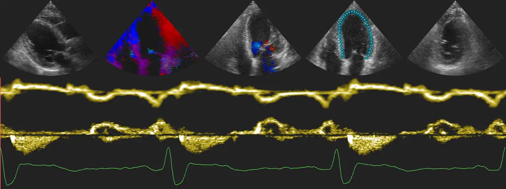
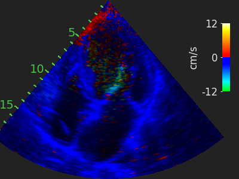
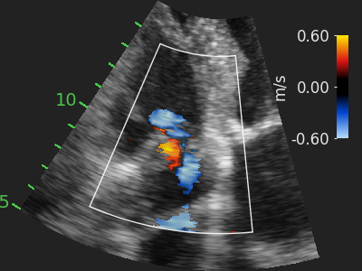
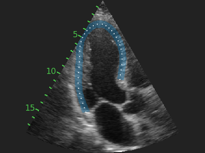
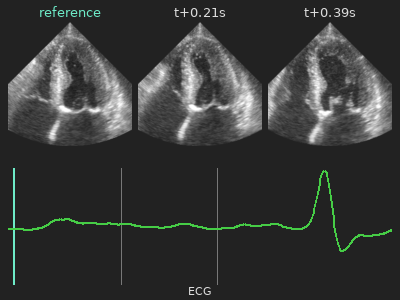

<h1 align="center">EchoXFlow</h1>

<p align="center">
  <strong>A Beamspace Echocardiography Dataset for Cardiac Motion, Flow, and Function</strong>
</p>

<p align="center">
  <a href="https://huggingface.co/datasets/Ahus-AIM/EchoXFlow">
    
  </a>
  <a href="http://arxiv.org/abs/2605.05447">
    
  </a>
  <a href="https://github.com/Ahus-AIM/EchoXFlow/actions/workflows/ci.yml">
    
  </a>
</p>

<p align="center">
  
</p>

<p align="center">
  <sub><b>A small subset of an echocardiographic examination.</b> Top row, left to right: parasternal long axis, tissue Doppler, colour Doppler, strain imaging, parasternal short axis.
  Second row: pulsed-wave tissue velocity. Third row: transmitral and aortic flow. Last row: electrocardiogram.
  Reproduce this figure with <a href="scripts/render_banner.py">scripts/render_banner.py</a>.</sub>
</p>

---

## Overview

**EchoXFlow** provides echocardiography recordings stored as Croissant metadata and Zarr recording stores.

This repo supports parsing, visualisation and dataloading of time-resolved 1D, 2D, and 3D B-mode and Doppler data.

---

## Highlights

- Read EchoXFlow data from Croissant metadata and Zarr stores
- Load typed streams for brightness-mode, Doppler, and ECG data
- Render frames and videos for inspection

---

## Benchmark Tasks

<table width="100%">
  <tr>
    <td align="center" width="25%">
      <strong><a href="tasks/tissue_doppler">Task 1: Tissue Velocity</a></strong><br>
      <a href="tasks/tissue_doppler">
        
      </a>
    </td>
    <td align="center" width="25%">
      <strong><a href="tasks/color_doppler">Task 2: Blood Flow</a></strong><br>
      <a href="tasks/color_doppler">
        
      </a>
    </td>
    <td align="center" width="25%">
      <strong><a href="tasks/segmentation">Task 3: Segmentation</a></strong><br>
      <a href="tasks/segmentation">
        
      </a>
    </td>
    <td align="center" width="25%">
      <strong><a href="tasks/video_diffusion">Task 4: ECG-to-Video</a></strong><br>
      <a href="tasks/video_diffusion">
        
      </a>
    </td>
  </tr>
</table>

Tasks 1-3 share one training and evaluation pipeline and can be run with any of the benchmark models. Task 4 trains a
video diffusion model that takes one frame and the ECG as input and is evaluated with feature-space distances.

---

## Dataset Setup

Download the dataset from:

**🤗 https://huggingface.co/datasets/Ahus-AIM/EchoXFlow**

This reader requires dataset schema **`EchoXFlow-2` or newer**. The original `EchoXFlow-1` export
is not supported. Check the export release notes and schema metadata before downloading; the
Python package version and dataset release version are separate identifiers.

Point EchoXFlow at the dataset with `export ECHOXFLOW_DATA_ROOT=/path/to/EchoXFlow`, or pass `--data-root` to a
script.

---

## Reproduce Our Results

Install the task dependencies (see [Installation](#installation)), point `DATA` at the dataset, `CAMUS` at the
[CAMUS EchoXFlow package](https://huggingface.co/datasets/Ahus-AIM/CAMUS-beamspace) and `OUT` at a disk with about
100 GB free, configure the foundation-model weights as described in [docs/REPRODUCE.md](docs/REPRODUCE.md), then run:

```bash
export DATA=/path/to/EchoXFlow CAMUS=/path/to/CAMUS-beamspace OUT=/path/with/space
scripts/run_paper_pipeline.sh --data-root "$DATA" --camus-root "$CAMUS" --output-dir "$OUT"
uv run python scripts/croissant_summary_table.py "$DATA/croissant.json" --view-csv "$DATA/view_classifier_probabilities.csv"
```

The first command trains and evaluates every model of the paper (Tasks 1-4, the CAMUS evaluations and the
foundation-model EF comparison). The second builds the dataset tables. More details in
[docs/REPRODUCE.md](docs/REPRODUCE.md).

Task 4 also requires the `diffusion-eval` extra and the extractor weights/checkouts described in
[tasks/video_diffusion/PROTOCOL.md](tasks/video_diffusion/PROTOCOL.md#evaluation). Missing requested evaluators fail the run.

---

## Installation

Requires **Python 3.13 or newer**. Run the commands below from a cloned repository checkout.
The `tasks/` and `scripts/` workflows run from that checkout; installing the library wheel alone
does not install the paper reproduction scripts.

```bash
uv sync                      # library
uv sync --extra tasks        # + benchmark tasks and models (includes torch)
uv sync --extra pandas       # + catalog.to_dataframe()
uv sync --extra tasks --extra diffusion-eval   # + Task 4 feature extractors
```

With pip: `pip install -e ".[tasks]"`.

---

## Quick Start

```python
from echoxflow import load_croissant, open_recording, render_recording_video, save_recording_plot

catalog = load_croissant(root="/path/to/EchoXFlow")  # root not needed if set in the config or ECHOXFLOW_DATA_ROOT
record = catalog.filter(content_types=("2d_color_doppler",))[0]

with open_recording(record) as store:
    power = store.load_stream("2d_color_doppler_power")
print(power.data.shape, power.timestamps.shape)  # (T, depth, beams) (T,)

save_recording_plot(record, "outputs/frame.png", view_mode="both")  # one frame, beamspace and Cartesian side by side
render_recording_video(record, "outputs/clip.mp4", view_mode="both")  # the whole recording as a video
```

Catalog records retain their dataset root. An explicit `root=` overrides it. Use `open_recording` as a
context manager (or call `store.close()`); loaded arrays remain usable after closing.

### Filtering

> [!TIP]
> There are two ways of filtering:
> - `catalog.filter(...)` returns records directly and covers the common cases.
> - `catalog.to_dataframe()` is for exploring in a notebook, with counts, group-bys and any condition pandas can
>   express. `catalog.select(df)` maps the rows back to records.
>
> Each record has `fold`, `view`, `content_types` and `annotations`. The view labels are described in
> [docs/VIEWS.md](docs/VIEWS.md).

```python
from echoxflow import load_croissant

catalog = load_croissant(root="/path/to/EchoXFlow")  # root not needed if set in the config or ECHOXFLOW_DATA_ROOT

a4c_train = catalog.filter(views=("A4C",), exclude_folds=(4,), content_types=("2d_brightness_mode",))
# A4C B-mode recordings of the four training folds

strain = catalog.filter(annotated=("lv_strain_contour",))
# recordings with a left-ventricular strain contour

a4ch_lv = catalog.filter(views=("a4ch-lv",), view_source="echofine", min_view_confidence=0.9)
# recordings EchoFine labels a4ch-lv with probability 0.9 or more

volumes = catalog.filter(content_types=("3d_brightness_mode",), annotated=("lv_mesh",))
# 3D recordings with a left-ventricular mesh
```

With pandas (`uv sync --extra pandas`):

```python
from echoxflow import load_croissant, open_recording, render_recording_video

root = "/path/to/EchoXFlow"
catalog = load_croissant(root=root)

df = catalog.to_dataframe()
# one row per recording: exam_id, recording_id, fold, view, content_types, annotations, has_* flags, ...

df["view"].value_counts()
# A4C 9835, PSAX 5955, PLAX 5139, Other 4553, A3C 2047, A2C 1999

a4c = df[(df.view == "A4C") & (df.fps_bmode >= 30)]
# 2904 A4C B-mode recordings at 30 fps or more

plax_color = df[(df.view == "PLAX") & df.has_2d_color_doppler]
# 1431 PLAX recordings with colour Doppler

volumes = df[df.is_3d & df.has_lv_mesh]
# 201 3D recordings with an LV mesh

records = catalog.select(a4c)
# tuple of RecordingRecord, for open_recording, render_recording_video or ClipDataset

render_recording_video(records[0], "outputs/a4c.mp4", root=root)
with open_recording(records[0]) as store:
    frames = store.load_stream("2d_brightness_mode").data
```

### Building a dataset

Needs torch (`uv sync --extra tasks`).

```python
from torch.utils.data import DataLoader

from echoxflow import load_croissant
from echoxflow.torch import ClipDataset, collate_clips

root = "/path/to/EchoXFlow"
catalog = load_croissant(root=root)
records = catalog.filter(views=("A4C",), exclude_folds=(4,))

dataset = ClipDataset(records, clip_length=32, stride=16, root=root)
frames, timestamps, record = dataset[0]
loader = DataLoader(dataset, batch_size=8, collate_fn=collate_clips)
```

---

## Development

```bash
uv sync --group dev --extra tasks
uv run pre-commit install
uv run pre-commit run --all-files   # ruff, mypy, yamllint
uv run pytest
```

---

## License

CC BY-NC-SA 4.0, see [LICENSE](LICENSE).

---

## Citation

The EchoXFlow dataset paper is published in the NeurIPS 2026 Evaluations & Datasets track.

```bibtex
@inproceedings{stenhede_2026_echoxflow,
  title = {EchoXFlow: A Beamspace Echocardiography Dataset for Cardiac Motion, Flow, and Function},
  author = {Stenhede, Elias and Sulkowska, Joanna and Orstad, Eivind Bj{\o}rkan and Schirmer, Henrik and Ranjbar, Arian},
  booktitle = {Advances in Neural Information Processing Systems (NeurIPS), Evaluations and Datasets Track},
  year = {2026},
  eprint = {2605.05447},
  doi = {10.48550/arXiv.2605.05447},
  url = {https://arxiv.org/abs/2605.05447}
}
```

If you use the view labels, also cite the classifiers they come from, EchoPrime and EchoFine (EchoView47):

```bibtex
@article{vukadinovic_2025_echoprime,
  title = {Comprehensive echocardiogram evaluation with view primed vision language AI},
  author = {Vukadinovic, Milos and Chiu, I-Min and Tang, Xiu and Yuan, Neal and Chen, Tien-Yu and Cheng, Paul and Li, Debiao and Cheng, Susan and He, Bryan and Ouyang, David},
  journal = {Nature},
  volume = {650},
  number = {8103},
  pages = {970--977},
  year = {2026},
  doi = {10.1038/s41586-025-09850-x}
}

@article{naidoo_2026_echofine,
  title = {Robust fine-grained echocardiographic view classification with supervised contrastive learning},
  author = {Naidoo, Preshen and Fernandes, Patricia and Dadashi Serej, Nasim and Stowell, Catherine C. and Manisty, Charlotte H. and Francis, Darrel P. and Zolgharni, Massoud},
  journal = {Medical Image Analysis},
  volume = {110},
  pages = {104006},
  year = {2026},
  doi = {10.1016/j.media.2026.104006}
}
```
