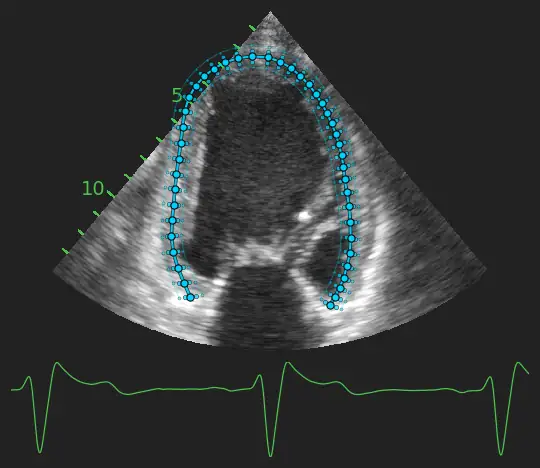

# Task 3: Segmentation of Myocardium and Endocardium

<p align="center">
  
</p>

Segment the left-ventricle myocardium and endocardium from B-mode clips with contour annotations. The task predicts the LV structures frame by frame for downstream shape and function analysis.

The benchmark metric is `dice_mean`, the thresholded (argmax) Dice averaged over the structures present in each clip,
then over clips and examinations (see [Evaluation Metrics](../README.md#evaluation-metrics)). The soft Dice of earlier
releases is kept as `soft_dice_mean`.

```bash
uv run python -m tasks.train segmentation --data-root /path/to/EchoXFlow
```

## External CAMUS evaluation

Evaluate every benchmark checkpoint (all methods, domains, folds and resolutions) on the 1,000 recordings of the
[CAMUS EchoXFlow package](https://huggingface.co/datasets/Ahus-AIM/CAMUS-beamspace), prepared exactly like a Task 3
validation clip and scored with the benchmark's own Dice over all frames and at the ED and ES frames:

```bash
uv run --extra tasks python -m tasks.segmentation.camus \
  --package-root /path/to/CAMUS-beamspace --benchmark-root outputs/bench --output-dir outputs/segmentation_camus
```

For a smoke run, add `--methods frame_unet temporal_unet --max-recordings 2`. One
`per_recording_r<R>_<domain>.csv` is written per resolution and domain.
