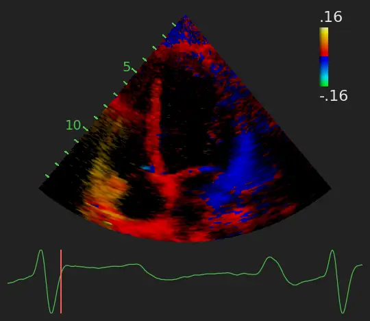

# Task 1: Estimation of Tissue Velocity

<p align="center">
  
</p>

Predict dense tissue Doppler velocity maps from B-mode clips. The task uses the brightness-mode sequence as input and estimates myocardial tissue velocity over the same temporal window.

The benchmark metric is `velocity_l1`: the mean absolute (aliasing-wrapped) velocity error in m/s inside the scan
sector, reported in cm/s. `velocity_nyquist_l1` gives the same error as a fraction of each recording's velocity limit.
Metrics are computed per clip and averaged over examinations (see [Evaluation Metrics](../README.md#evaluation-metrics)).

```bash
uv run python -m tasks.train tissue_doppler --data-root /path/to/EchoXFlow
```
