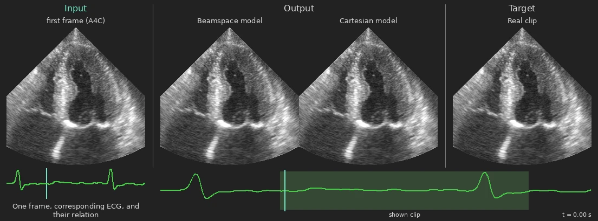
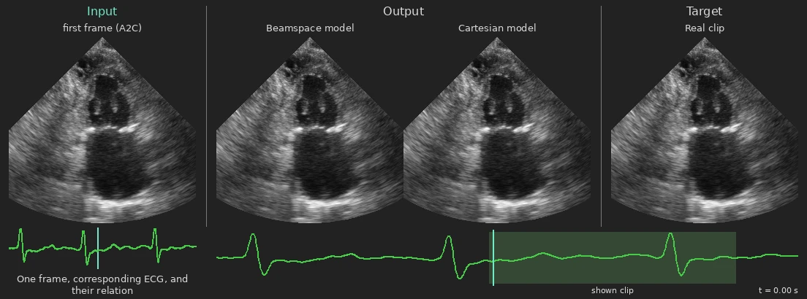
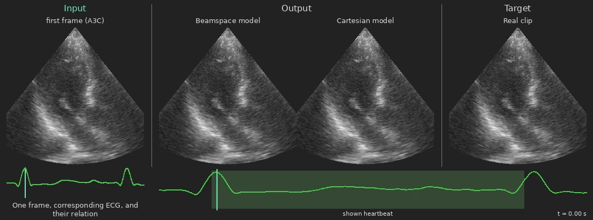
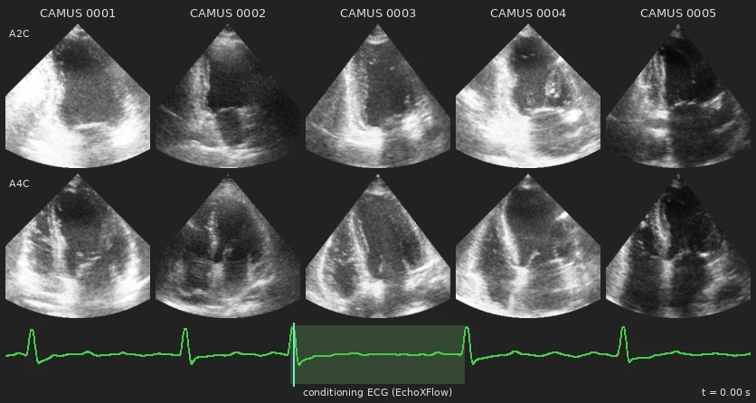

# Task 4: ECG-Conditioned Video Generation

Generate 31 future ultrasound frames from one frame and its synchronized ECG. The task compares video diffusion
in beamspace and Cartesian coordinates across apical A2C, A3C and A4C views.

<p align="center">
  <br>
  <em>Input: one frame + ECG. Output: beamspace and Cartesian predictions. Target: the real clip.</em>
</p>

## Examples

Selected held-out clips from the **epoch 10, 256-pixel models**. The A4C example above is LV-centred at 13 cm depth.
A2C and A3C are below. The moving ECG marker follows playback, and A3C loops over one complete heartbeat.

<p align="center">
  <br>
  
</p>

## Generating CAMUS heartbeats

The beamspace model extends the end-diastolic frame of the first five
[CAMUS](https://huggingface.co/datasets/Ahus-AIM/CAMUS-beamspace) patients (A2C above A4C) over one heartbeat of an
EchoXFlow ECG. The resolution is 256 pixels and the model was trained on EchoXFlow in the beamspace representation.

<p align="center">
  
</p>

## Train and evaluate

Install the [task dependencies](../../README.md#installation), then run:

```bash
uv run python -m tasks.video_diffusion.train \
  --data-root /path/to/EchoXFlow \
  --coordinate-space beamspace --resolution 256 --evaluation-fold 4

uv run python -m tasks.video_diffusion.evaluate \
  --checkpoint <run>/ema.pt --data-root /path/to/EchoXFlow
```

Use `--coordinate-space cartesian` for the other model. The paper holds out each of the five examination-level folds in
turn. Evaluation compares generated and real clips using feature-space FD and KID. Training defaults to **10 epochs**.
Settings are in [train.yaml](train.yaml).

For data preparation, architecture, checkpointing, evaluation dependencies, paper reproduction and CAMUS, see the
[technical reference](PROTOCOL.md). [Media regeneration](PROTOCOL.md#media) is documented there too.
